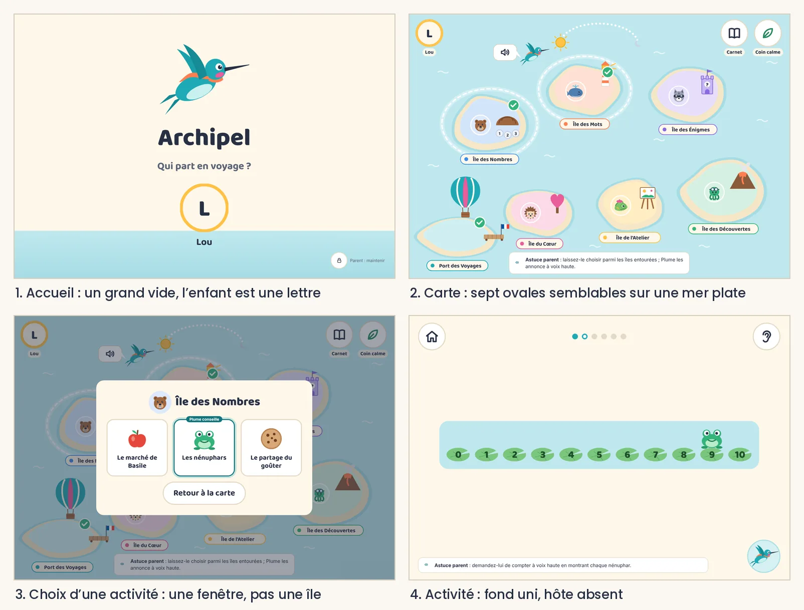
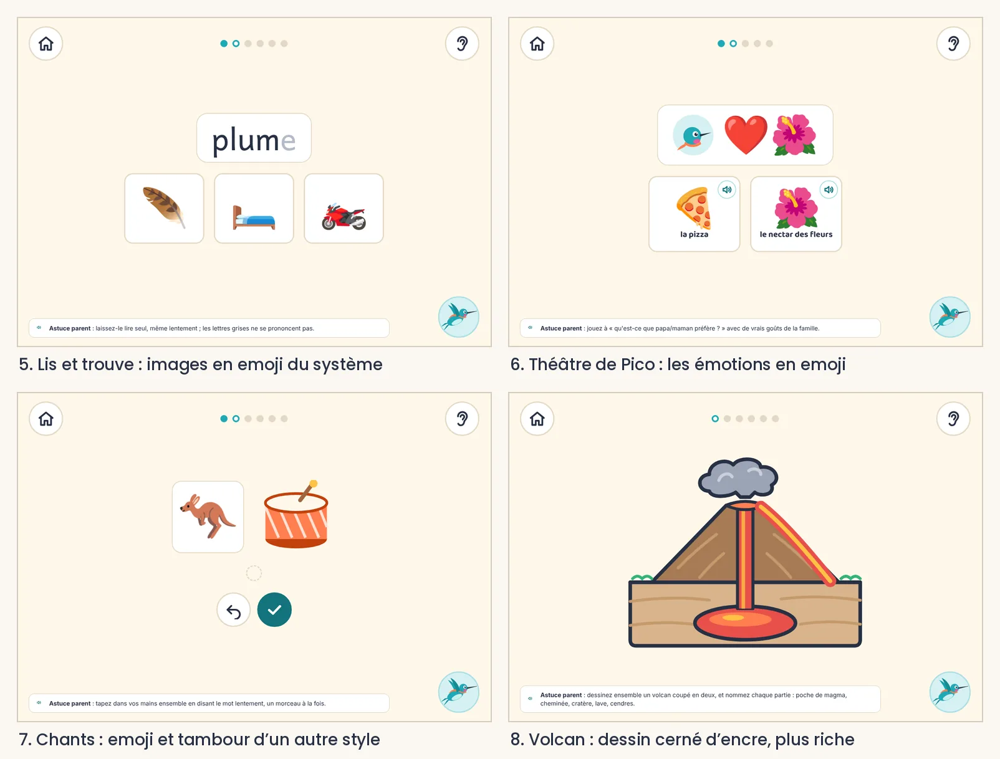
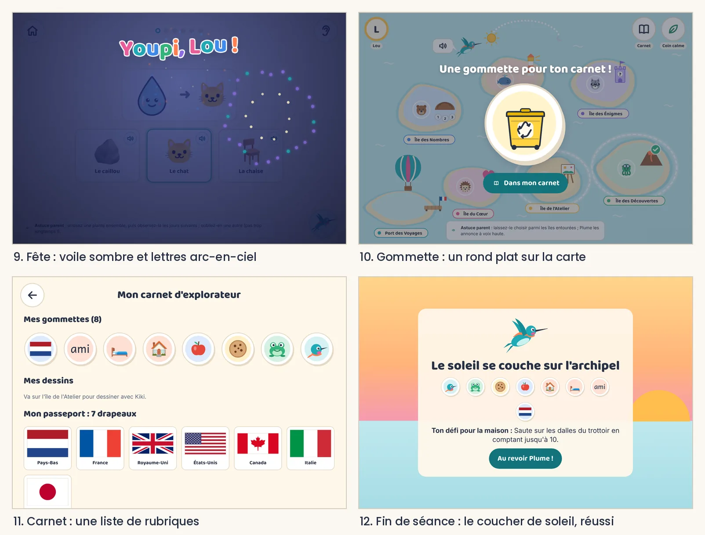
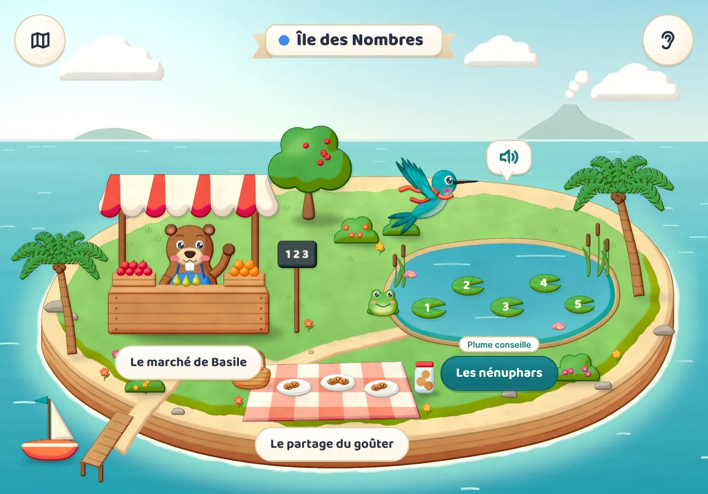
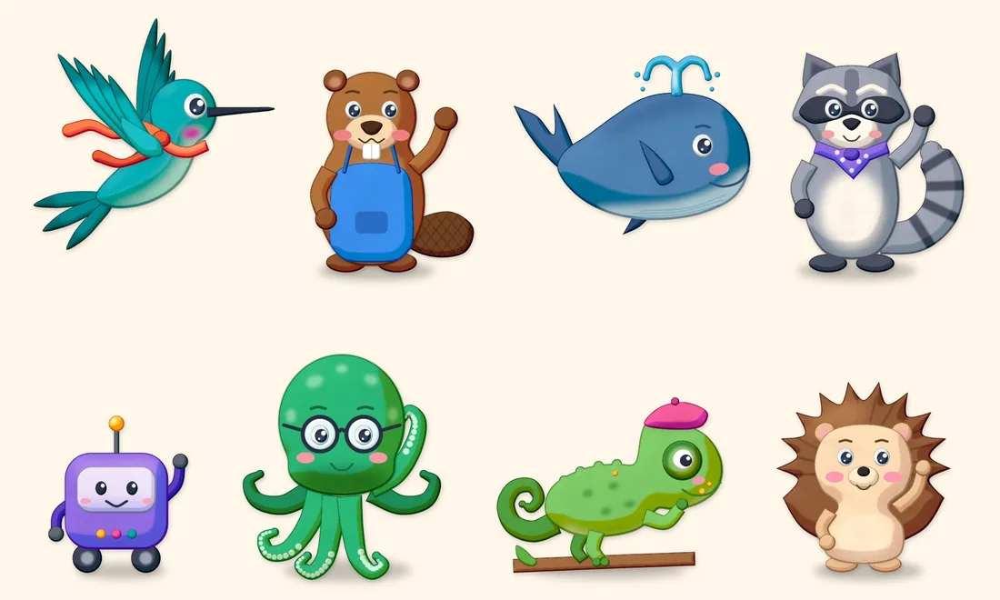
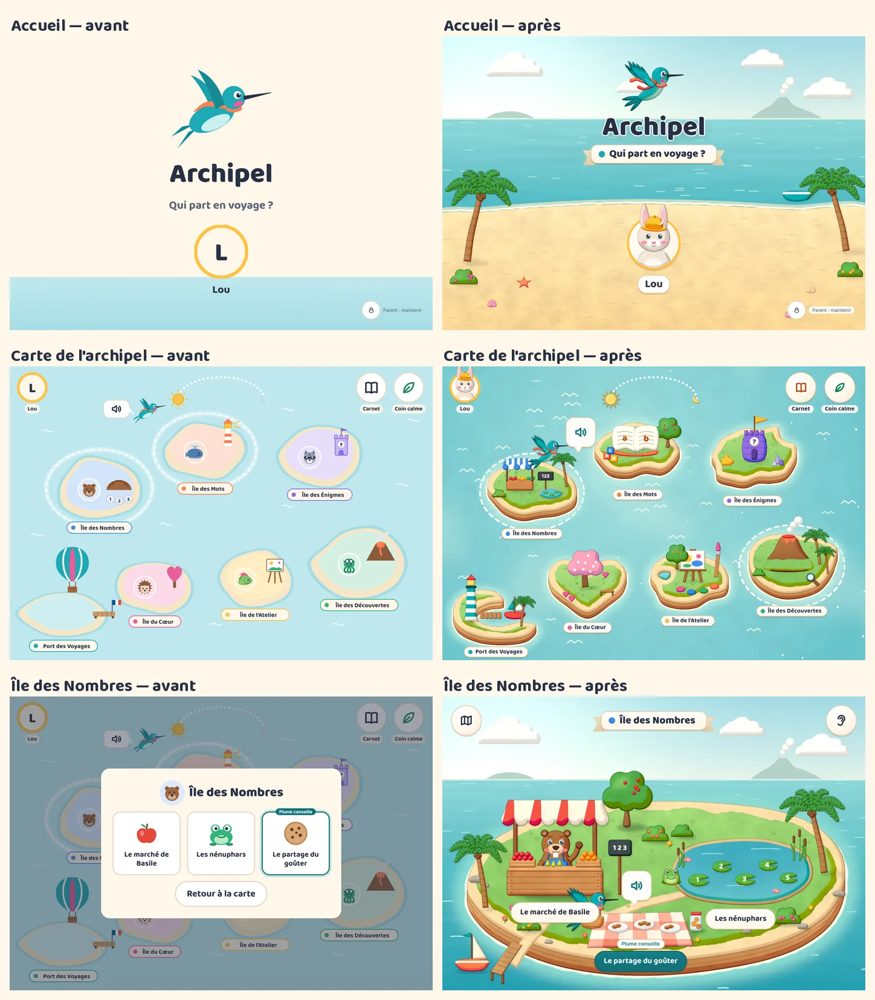
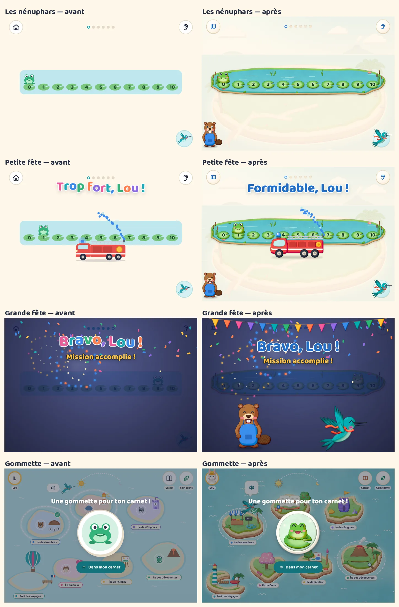
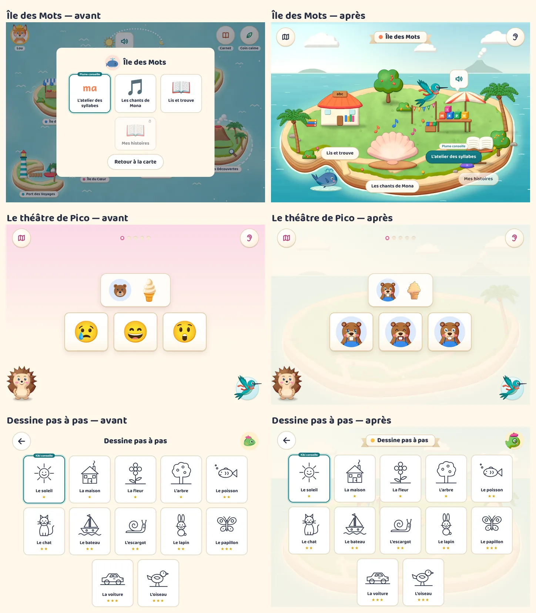
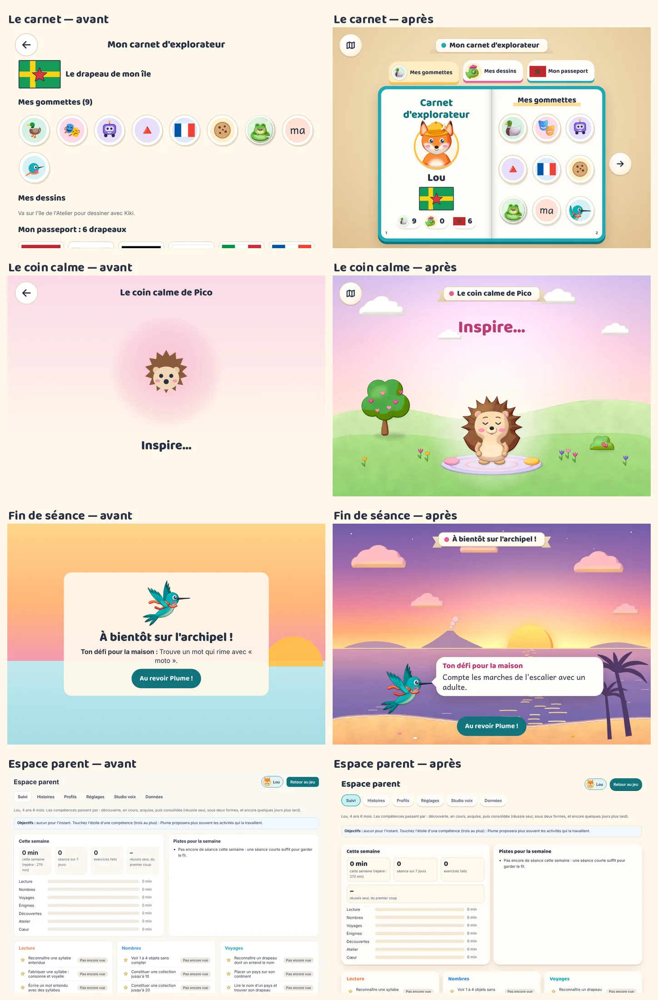

# Audit visuel d'Archipel (v1)

Ce document fait l'état des lieux de l'interface de la v1 avant la refonte : ce qui marche, ce qui manque, écran par écran, et les priorités. Il sert de référence « avant » pour comparer chaque livraison de la v2.

- Version auditée : v1, commit `8694fea` (branche `v1`).
- Méthode : chaque écran parcouru dans Chrome à la taille d'un iPad Air en paysage (1180 × 820), avec le prénom fictif des tests (« Lou »). Sur l'iPad, les emoji ont le dessin d'Apple, ce qui rend l'écart de style encore plus visible à côté des formes plates de Plume.
- Repères de la proposition pédagogique, toujours valables :
  - zones tactiles d'au moins 1,5 cm ;
  - trois boutons fixes (maison, oreille, Plume) ;
  - toucher et glisser seulement ;
  - jamais de rouge pour une erreur ;
  - animations de 200 à 400 ms.

## En bref

La v1 fonctionne de façon claire et cohérente, mais son image ne suit pas encore : trois styles de dessin se mélangent, les écrans sont presque vides et les personnages n'apparaissent qu'en médaillon.

La refonte change la peau, pas les organes : le moteur adaptatif, la pédagogie, la voix et le hors-ligne restent tels quels.

## Captures « avant »

*1. Accueil : un grand vide, l'enfant est une lettre. 2. Carte : sept ovales semblables sur une mer plate. 3. Choix d'une activité : une fenêtre, pas une île. 4. Activité : fond uni, hôte absent.*

*5. Lis et trouve : images en emoji du système. 6. Théâtre de Pico : les émotions en emoji. 7. Chants : emoji et tambour d'un autre style. 8. Volcan : dessin cerné d'encre, plus riche.*

*9. Fête : voile sombre et lettres arc-en-ciel. 10. Gommette : un rond plat sur la carte. 11. Carnet : une liste de rubriques. 12. Fin de séance : le coucher de soleil, réussi.*

## Les dix améliorations qui changeront le plus la qualité perçue

1. **Un seul style d'illustration pour tout** : personnages, décors, images d'exercice et gommettes.
2. **Des îles qu'on visite** : un écran par île où chaque lieu est une activité, à la place de la fenêtre à cartes.
3. **Une carte vivante** : sept îles toutes différentes, du relief, de l'eau qui bouge, et Plume qui vole vers la mission proposée.
4. **Les personnages en entier** : présents dans leur île et dans leurs activités, avec des expressions et des réactions.
5. **Un cadre d'activité habité** : un décor léger de l'île derrière la zone de jeu, l'hôte à côté.
6. **Un imagier embarqué à la place des quelque 200 emoji** : même dessin sur tous les appareils, mots sans ambiguïté.
7. **Des fêtes redessinées** :
   - l'hôte réagit ;
   - le message est d'une seule couleur ;
   - une grande scène finale clôt l'activité.
8. **Un accueil où l'enfant se reconnaît** : un avatar dessiné qu'il choisit, et pas seulement son initiale.
9. **Un système de design central** : couleurs, textes, espacements, ombres et mouvements définis une seule fois.
10. **Des transitions entre écrans et une réponse « jouet » à chaque contact** (son doux, petit mouvement), avec le réglage « Réduire les animations » respecté.

## Écran par écran

| Écran | Ce qui marche | Ce qui manque | Priorité |
|---|---|---|---|
| Accueil | lisible, Plume bien en vue, cadenas discret | un grand vide crème, aucun décor ; l'enfant est une lettre dans un rond | 1 |
| Carte | missions et soleil compréhensibles, îles bien espacées, portrait géré | sept fois le même ovale à trois teintes, mer plate, repères minuscules, rien ne bouge | 1 |
| Choix d'une activité | « Plume conseille » est clair | une fenêtre sur la carte grisée, des emoji en guise d'images : on ne visite pas l'île | 1 |
| Cadre d'activité | trois boutons fixes partout, progression, astuce parent | fond uni, zone de jeu petite au centre, hôte absent | 1 |
| Lecture : syllabes, lis et trouve, chants | Andika grande et nette, syllabes soulignées, lettres muettes en gris | images en emoji ; tambour d'un autre style | 1 |
| Théâtre de Pico | situations bien choisies | les émotions passent par des emoji, pas par les visages des personnages | 1 |
| Fêtes de réussite | joyeuses, variées, prénom affiché | voile sombre et lettres arc-en-ciel hors de l'univers ; 2 à 4,5 s après chaque bonne réponse | 1 |
| Nombres : marché, nénuphars, partage | manipulation au doigt, grandes cibles | les nénuphars sont un rectangle bleu, le goûter des assiettes blanches : aucun lieu | 2 |
| Énigmes : formes, Bip, motifs | géométrie nette | très sobre, Rico absent | 2 |
| Découvertes : goutte, volcan, tri, déchets, flotte | les dessins les plus riches de l'appli (Ploc, volcan coupé, camion) | style cerné d'encre, différent du reste ; réponses en emoji dans la goutte et le bassin | 2 |
| Gommette | rituel juste : jamais promise, toujours expliquée | un rond plat, sans matière | 2 |
| Carnet | tout y est | une liste de rubriques, pas un carnet qu'on feuillette | 2 |
| Fin de séance | coucher de soleil réussi, défi hors écran | pas de récapitulatif en images | 2 |
| Coin calme | doux, bien rythmé | Pico réduit à sa tête | 3 |
| Espace parent | complet, sobre | dense et générique ; à harmoniser seulement | 3 |

## Par thème

- **Identité.** Plume Aventurier est réussi et reconnaissable ; le reste de l'univers n'a pas encore de personnalité propre.
- **Couleurs.** Contraste du texte très bon (encre sur crème : environ 12 pour 1) et couleurs d'îles bien distinctes. Mais tout est en aplats pastel, sans ombre ni lumière : les écrans paraissent plats.
- **Typographie.** Bonnes polices (Andika pour lire, Baloo 2 pour les titres, Inter pour l'adulte), mais chargées depuis Google : le seul appel extérieur dans l'expérience de l'enfant. Les activités n'ont pas de titre, seulement des points.
- **Hiérarchie.** Les éléments ont tous le même poids visuel : bordure beige, fond blanc. Rien ne guide l'œil vers ce qu'il faut toucher.
- **Navigation.** Claire et constante. Le rond de l'enfant sur la carte sert à arrêter le voyage, ce qu'un enfant ne devine pas.
- **Interactions et animations.** Appui qui rétrécit, balancement en cas d'erreur, bordure verte en cas de réussite : juste, mais minimal. Aucune transition entre écrans : l'écran change d'un coup.
- **Tablette.** Tout est calé sur l'iPad Air en paysage et s'adapte bien au portrait. Les boutons ronds font 86 px, soit environ 1,6 cm (58 px au minimum sur un petit écran), les petits 52 px.

## Inventaire

- **Écrans.** L'enfant traverse une douzaine d'écrans, tous dessinés par du code (SVG et CSS écrits en TypeScript), sans fichier d'image :
  - accueil, grand départ, carte, choix d'une activité ;
  - 17 modules d'activité, fêtes, gommettes ;
  - carnet, coin calme, fin de séance ;
  - dessin pas à pas et miroir, drapeau de mon île, mes histoires.
- **Composants partagés** (`ui.ts`, `screens/common.ts`) :
  - boutons ronds, points de progression, cartes de réponse ;
  - fenêtres, astuce parent, haut-parleur de carte ;
  - barrière adulte, plateau « glisser » du tri ;
  - fêtes et gommettes.
- **Styles.** Trois textes CSS dans le code. Quatorze couleurs sont déclarées en variables. Hors dessins et drapeaux, 126 autres couleurs sont écrites en dur, 504 fois, dans 30 fichiers : il n'y avait pas de système de design central.
- **Images.** Trois styles se mélangent :
  - formes générées par script (personnages, carte) ;
  - dessins par activité (volcan, poubelles, camion) ;
  - environ 200 emoji du système utilisés comme images, dont le dessin change d'un appareil à l'autre.

## Suivi de la refonte

| Livraison | Ce qui répond à l'audit | Captures « après » |
|---|---|---|
| 0, cohabitation | rien de visible : la v2 vit à côté de la v1, avec son nom, son icône et son stockage | — |
| 1, fondations | <ul><li>polices embarquées (plus d'appel à Google) ;</li><li>système de design central ;</li><li>atelier d'illustration, personnages en entier et cinq expressions ;</li><li>modèle des îles, île des Nombres dessinée ;</li><li>imagier de 195 images ;</li><li>vitrine pour juger sur l'iPad.</li></ul>Rien ne change encore dans les écrans de l'enfant. | ci-dessous |
| 2, pilote | <ul><li>accueil sur la plage, compagnon de voyage dessiné (l'enfant se reconnaît) ;</li><li>carte aux sept îles dessinées, toutes différentes ;</li><li>écran de l'île des Nombres ;</li><li>cadre d'activité habité (hôte qui réagit, décor léger, matière album) pour toutes les activités ;</li><li>nénuphars redessinés ;</li><li>fêtes aux objets dessinés, message d'une couleur, rien ne clignote ; gommette dans la matière album ;</li><li>fondu entre les écrans.</li></ul> | ci-dessous |
| 3, généralisation | <ul><li>les sept îles dessinées, chacune avec son écran : on visite l'île, la fenêtre d'activités disparaît ;</li><li>l'imagier à la place des emoji dans toutes les activités ;</li><li>visages dessinés des personnages : médaillons de toutes les activités, émotions du théâtre de Pico ;</li><li>gommette dans sa lumière ; carnet qu'on feuillette ;</li><li>fin de séance peinte ; coin calme avec Pico entier qui respire ;</li><li>écrans à part (dessin, miroir, drapeau de mon île, histoires) dans le cadre des activités ;</li><li>espace parent harmonisé.</li></ul> | ci-dessous |

*Livraison 1 : l'île des Nombres telle qu'elle sera au pilote, montée dans la vitrine (`…/v2/#vitrine`) à partir du décor, des lieux et des composants.*

*Livraison 1 : Plume et les hôtes des îles, en entier, dans la finition album.*

*Livraison 2 : le même parcours avant (à gauche) et après (à droite), iPad en paysage, profil « Lou ».*

*Livraison 2 : l'activité des nénuphars dans son cadre habité, les fêtes et la gommette.*

*Livraison 3 : l'île des Mots dessinée (au lieu de la fenêtre d'activités), le théâtre de Pico avec les visages des personnages, le dessin pas à pas dans le cadre de l'Atelier.*

*Livraison 3 : le carnet qu'on feuillette, le coin calme avec Pico entier, la fin de séance peinte, l'espace parent harmonisé.*
