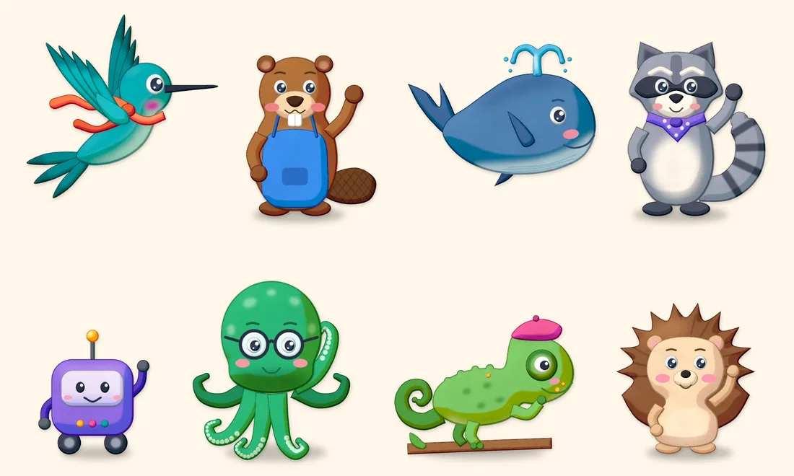
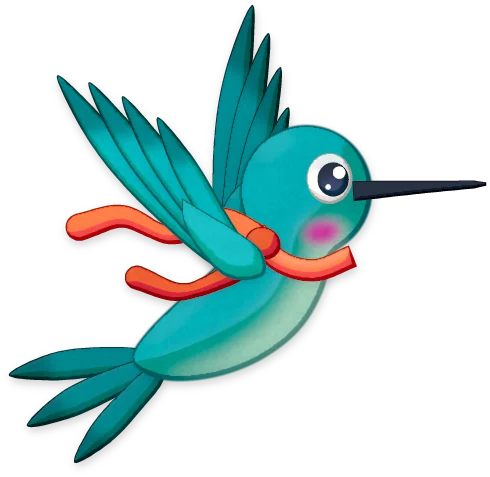
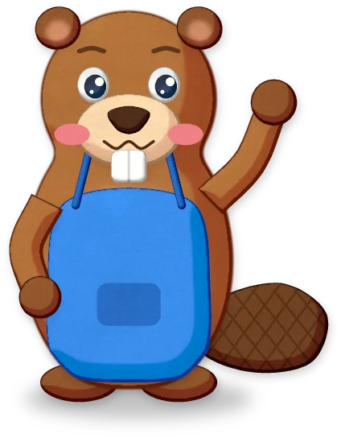
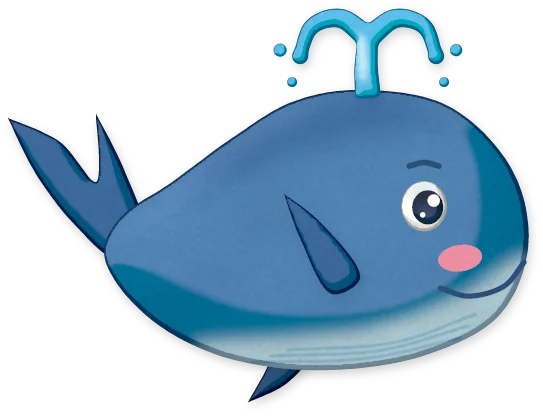
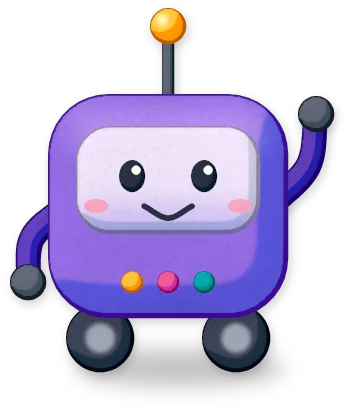
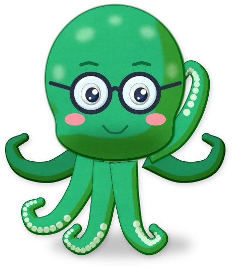
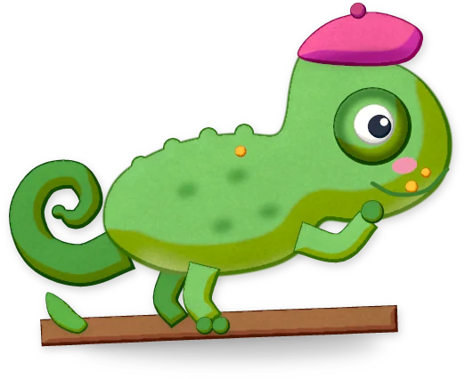
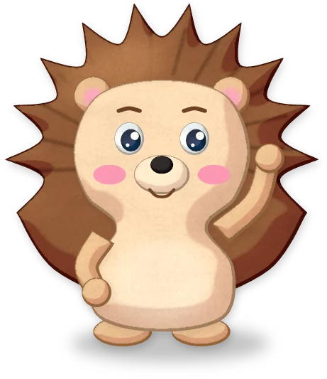

# Guide des personnages d'Archipel 2

Plume et les hôtes des sept îles, redessinés pour la v2 dans la finition album (voir `identite-visuelle.md`). Ce sont les mêmes personnages que dans la v1, avec les mêmes noms et les mêmes signes : on les améliore, on ne les remplace pas. Ce guide sert de cahier des charges pour toute nouvelle pose, toute nouvelle expression, ou un illustrateur de métier un jour.

Les dessins sont fabriqués par l'atelier : `scripts/illustration/personnages.py` pour Plume et Basile, `scripts/illustration/hotes.py` pour les autres. Ils sont rendus dans `public/illustrations/personnages/` et catalogués dans `src/illustrations.ts`.

## Règles communes

- **Une seule silhouette**, souple et fusionnée (corps et tête d'un seul tenant), la lumière en haut à gauche, la texture gouache, un trait coloré. Jamais de formes simples empilées.
- **Grands yeux** blancs à pupille sombre, avec deux reflets ; **joues roses** ; bouche simple.
- **Les signes ne bougent pas** : couleur du corps, accessoire, détail distinctif. Un enfant de 4 ans doit reconnaître chaque personnage de loin et en silhouette.
- **Chacun porte ou rappelle la couleur de son île** sans en être recouvert : le tablier bleu de Basile, le foulard violet de Rico.
- **En entier**, debout sur une ombre de contact, sauf Plume et Mona qui flottent.
- **Jamais méchant, jamais moqueur.** Après un essai raté, l'hôte prend l'expression « doux » : il encourage, il ne gronde pas.
- **Le personnage-guide est l'élément le plus calme de l'écran** : gestes lents, respiration lente, pas de sautillement continu.

## Les cinq expressions

Communes à tous (`EXPRESSIONS` dans `personnages.py`) :

| Expression | Yeux | Bouche | Sourcils | Quand |
|---|---|---|---|---|
| content | ouverts | sourire | au repos | par défaut, accueil, consigne |
| rieur | en arc fermé | grande ouverte, langue | un peu levés | réussite, fête |
| surpris | grands ronds, pupille petite | petit « o » | très levés | découverte, surprise du décor |
| pensif | regardent en l'air | moue de côté | un peu froncés | indice, « réfléchissons » |
| doux | souriants (paupière du bas qui remonte) | petit sourire | bouts intérieurs relevés | après un essai : encourager |

Chaque hôte existe aussi en **salut** (content, un bras, une nageoire ou une patte levée).

Les émotions du théâtre de Pico (tristesse, colère, peur, déception) seront ajoutées avec l'île du Cœur, sur les visages des personnages, à la place des emoji.

## Plume, le colibri voyageur : guide de l'enfant

- **Île** : Port des Voyages, turquoise `#1FA9B5`. Plume accompagne l'enfant partout, sur toutes les îles.
- **Signes à garder** :
  - corps turquoise et ventre clair (`#C4F0EA`) ;
  - **écharpe corail** (`#FF7F50`) dont les pans flottent ;
  - **joue framboise** ;
  - **long bec sombre et fin** ;
  - grand œil.
- **Silhouette** : fine d'aventurière, des plumes (et non des triangles) : quatre rémiges par aile, trois plumes de queue au bout plus sombre.
- **Poses** (`plume-<pose>.webp`) :
  - `vol` : en vol ;
  - `salut` : l'aile arrière levée ;
  - `montre` : l'aile avant pointe un lieu ;
  - `pense` : l'aile repliée, l'œil en l'air ;
  - `fete` : ailes hautes, bec ouvert.
- **Expressions en vol** : `plume-vol-rieur`, `-surpris`, `-pensif`, `-doux`.
- **En pièces pour l'animer** :
  - `plume-piece-aile-ar`, `plume-piece-corps`, `plume-piece-aile-av` sont alignées dans le même cadre ;
  - chaque aile pivote autour de l'épaule (`pivot` dans le catalogue) ;
  - battement lent et souple : 1,1 s par aller, de +3° à −16°, avec un léger flottement du corps.
- **Caractère** : curieuse, chaleureuse, jamais pressée. Elle parle à l'enfant (elle le tutoie), conseille une activité et ne la lui impose jamais.
- **Elle** : dans les textes, Plume est au féminin (« Plume a faim : que va-t-elle choisir ? »).
- **Non-copie** : un autre colibri existe dans une appli de référence. Plume s'en distingue par sa silhouette fine, son écharpe corail et sa palette turquoise, à garder telles quelles.

## Basile, le castor du marché : île des Nombres

- **Couleur de l'île** : bleu `#3D8BEA`.
- **Signes à garder** :
  - fourrure brune (`#A9703F`), ventre clair ;
  - **deux grandes dents blanches** ;
  - truffe sombre, oreilles rondes ;
  - **tablier bleu à poche** ;
  - queue plate quadrillée.
- **Lieux** : le marché (derrière son étal), les nénuphars, le partage du goûter.
- **Caractère** : commerçant jovial et patient, il compte avec l'enfant. Il adore ronger des branches et n'aime pas le chocolat.
- **Il.**

## Mona, la baleine qui chante : île des Mots

- **Couleur de l'île** : corail `#FF7F50`.
- **Signes à garder** :
  - **baleine bleue** (`#4E7FB0`) au **ventre clair rayé** ;
  - **jet d'eau** qui s'ouvre en fontaine au-dessus de la tête ;
  - grand sourire le long de la mâchoire ;
  - joue rose.
- **Silhouette** : un haricot, grosse tête ronde à droite ; la queue en V se relève. Pour saluer, elle lève sa nageoire.
- **Lieux** : les chants, l'atelier des syllabes, lis et trouve, mes histoires.
- **Caractère** : douce et musicale, elle chante les sons et les syllabes. Elle adore quand il pleut sur la mer.
- **Elle.**

## Rico, le raton laveur détective : île des Énigmes

- **Couleur de l'île** : violet `#8C6BE0`.
- **Signes à garder** :
  - fourrure grise (`#9AA0B4`), ventre et museau clairs ;
  - **masque sombre** sur les yeux et sourcils blancs au-dessus ;
  - **oreilles pointues** à l'intérieur sombre ;
  - **queue touffue à anneaux** ;
  - mains sombres.
- **Ajout v2** : un **foulard violet à pois**, la couleur de son île.
- **Lieux** : les formes, les motifs, et le chemin de Bip avec son robot.
- **Caractère** : malin, observateur, adore les énigmes. Il n'aime pas du tout les bananes.
- **Il.**

## Bip, le petit robot de Rico : île des Énigmes

- **Signes à garder** :
  - corps violet arrondi ;
  - **écran clair** où s'affichent ses yeux et sa bouche ;
  - **antenne à boule jaune** ;
  - deux roues sombres.
- **Ajout v2** : trois boutons de couleur.
- **Expressions sur l'écran** : yeux ovales, en arc pour rire et pour la douceur, ronds quand il est surpris.
- **Rôle** : il obéit aux flèches que l'enfant programme ; quand il se trompe de chemin, c'est un « bug » à trouver, jamais une faute de l'enfant.
- **Il.**

## Octave, la pieuvre savante : île des Découvertes

- **Couleur de l'île** : vert `#34B37A`.
- **Signes à garder** :
  - pieuvre verte (`#34B37A`) à la **tête en bulbe** tachetée ;
  - **lunettes rondes** à monture sombre et verres bleutés ;
  - **tentacules qui s'enroulent**, ventouses claires.
- **Pour saluer**, il lève un tentacule.
- **Lieux** : flotte ou coule, la goutte, le volcan, le grand tri, le voyage des déchets. C'est l'île la plus chargée, la première à passer en quartiers.
- **Caractère** : savant enthousiaste, il explique le monde avec des expériences. Il collectionne les coquillages.
- **Il.**

## Kiki, l'artiste caméléon : île de l'Atelier

- **Couleur de l'île** : jaune `#FFC145`.
- **Signes à garder** :
  - caméléon vert (`#7CC36B`), ventre clair, crête sur le dos ;
  - **grand œil en tourelle** cerclé de vert sombre ;
  - **queue en spirale** ;
  - **béret rose** posé de travers ;
  - **taches de peinture jaune** sur la joue.
- **Pose** : de profil sur sa branche, tournée vers la droite. Pour saluer, elle lève une patte.
- **Lieux** : dessine pas à pas, le miroir.
- **Caractère** : artiste rêveuse et joyeuse. Elle préfère les trains aux nounours.
- **Elle.**

## Pico, le hérisson au grand cœur : île du Cœur

- **Couleur de l'île** : rose `#E85D9A`.
- **Signes à garder** :
  - **manteau de piquants bruns** (`#8A5A3B`) autour de la tête et du dos ;
  - visage et ventre crème ;
  - **joues roses** ;
  - truffe sombre, petites oreilles rondes.
- **Lieux** : le théâtre de Pico, le coin calme (respirer avec lui).
- **Caractère** : sensible et rassurant. Il parle des émotions et aide à se calmer. Il adore les vers de terre, et il a parfois peur du noir.
- **Il.**
- **Dans le coin calme**, il doit apparaître en entier, avec une respiration lente : jamais réduit à sa tête.

## La grenouille des nénuphars

Petit personnage de l'île des Nombres : elle saute de nénuphar en nénuphar avec l'enfant. Vert tendre, ventre clair, deux yeux en dôme, joues roses (`frog()` dans `personnages.py`).

## Ajouter une pose ou une expression

1. Dessiner la variante dans la fonction du personnage (paramètre `expr`, `salut`, ou une nouvelle pose), dans le même repère.
2. L'ajouter à la liste de `fabriquer.py`, puis relancer `python3 scripts/illustration/fabriquer.py personnages`.
3. Vérifier sur la vitrine, puis la faire valider sur une planche (avec l'enfant si possible).

Ce qu'il ne faut jamais faire :

- changer une couleur de corps ou retirer un signe ;
- donner un air fâché ou moqueur à un hôte face à l'enfant ;
- faire bouger le guide plus vite que le décor.
